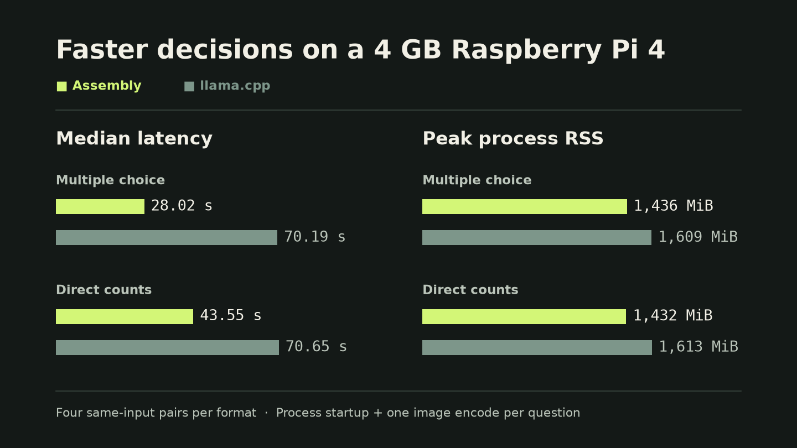
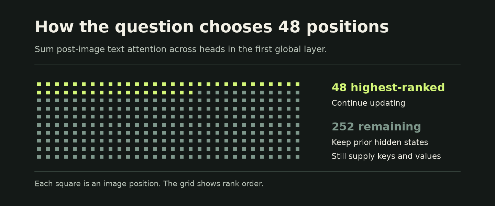

# d1-2B in ARM64 assembly on Raspberry Pi 4

A hobby inference engine for Liquid AI’s d1-2B on a 4 GB Raspberry Pi 4B. I used Codex to write the ARM64 inference path and autoresearch to tune it on the Pi.



## What made inference faster

### 1. Let the question select 48 of 300 image positions

The vision encoder processes the full 640×480 frame and supplies 300 image positions. In the first global backbone attention layer, the engine sums the post-softmax attention weights each image key receives from all heads and text positions after the image. It recalculates the ranking for each image and question. The 48 highest-scoring image positions and all text positions keep updating in the sparse part of the backbone. The other image positions keep their prior hidden states and remain available as attention keys and values. The engine retains the input positions needed by the seven-tap convolutions.



On four shared Pi diagnostic questions, median wall time fell from **42.58 s to 27.74 s**, with the same selected answers. This adapts established attention-guided token selection to d1’s mix of attention and short convolutions. [Full backbone diagnostic](benchmarks/reports/full-backbone-diagnostics.json) · [48-position diagnostic](benchmarks/reports/top48-diagnostics.json) · [FastV](https://arxiv.org/abs/2403.06764) · [SparseVLM](https://arxiv.org/abs/2410.04417)

**Direct counts keep all 300 image positions active.** The 48-position profile scored 7/16 and missed the accuracy target. The full backbone scored 8/16 and matched all 16 llama.cpp answers. [Count diagnostic](benchmarks/reports/sparse-counts.json) · [Full-backbone counts](benchmarks/reports/counts.json)

### 2. Fit all 11 packed Q6 batches into the counting path

The full backbone uses a compact Q6 kernel. For a 397-position prompt padded to 408 positions, the capacity check counted four bytes per activation and rejected the fast path. The packed layout uses about two bytes per value and occupies 6.3 MB of the available 12.3 MB. Checking that actual footprint let all 11 eligible batches use the packed kernel, up from one.

In four alternating Pi pairs, median wall time fell from **46.78 s to 43.58 s** and peak process RSS fell by **123 MiB**. All 16 numeric probability files matched the previous assembly build byte for byte. [Packed Q6 dispatch](research/d1-640x480/vision_fmla_batch.inc) · [Paired timings](benchmarks/reports/packed-q6.json)

### 3. Prepack Q4 and Q8 weights for NEON

Preparation rearranges the checkpoint’s quantized weights into tiles for the Pi’s NEON kernels. The Q4 backbone and Q8 vision kernels can load a tile once and apply it to several input positions. In a nine-question Pi test, the Q4 path saved **1.01 s per question** at the paired median and preserved every score file. A separate three-question test of the early Q8 vision path measured **1.01 s** at the paired median and preserved all three selected answers. [Q4 experiment](benchmarks/reports/packed-q4.json) · [Q8 experiment](benchmarks/reports/packed-q8.json)

## Benchmark results

The optimization timings above come from separate experiments. The table compares the complete engine against llama.cpp.

| Format | Assembly correct | llama.cpp correct | Median paired Pi speedup |
| --- | ---: | ---: | ---: |
| Multiple choice | 56/64 | 54/64 | **2.54×** |
| Direct counts (0–9) | 8/16 | 8/16 | **1.62×** |

The timing probes used four same-input pairs per format on the Pi. Full-set reference accuracy came from pinned x86 llama.cpp, whose answers matched Pi llama.cpp on all eight timing probes. [Protocol, reports, and all 80 answers](benchmarks/README.md)

## Build and run

Use 64-bit Raspberry Pi OS with GNU Make, GCC, glibc development headers, Python 3.10 or newer, and about 3 GB of disk space for the weights and generated assets. Obtain `d1-2B-Q4_K_M.gguf` and `mmproj-d1-2B-Q8_0.gguf` from the official GGUF repository. The preparation tools validate the exact checkpoint bytes and generate the packed Q4, Q6, and projector panels locally. [Liquid AI GGUF files](https://huggingface.co/LiquidAI/d1-2B-GGUF/tree/main)

Run these commands from the repository root.

```sh
python3 -m venv .venv
. .venv/bin/activate
python3 -m pip install -r requirements.txt

MODEL="$PWD/models/d1-2B-Q4_K_M.gguf"
PROJECTOR="$PWD/models/mmproj-d1-2B-Q8_0.gguf"
./tools/prepare-model.sh "$MODEL" "$PROJECTOR"
make

python3 research/d1-640x480/decide.py "$MODEL" "$PROJECTOR" photo.jpg examples/choice.json
python3 research/d1-640x480/decide.py "$MODEL" "$PROJECTOR" photo.jpg examples/count.json
```

Edit the example instructions and answer criteria for your photo. The helper applies aspect-preserving resize and gray padding to 640×480, prepares the checkpoint’s prompt and label plan, and prints the answer with its probabilities. It selects the full backbone for ordered scores and the 48-position profile for choices. The ARM64 binary performs inference. The direct-count example returns the median digit from the 0–9 score head.

The benchmarked build uses a 512-position context. Use a short prompt and a single image. The executable also accepts prepared RGB, prompt, and label-plan files directly. [ARM64 decision entry point](research/d1-640x480/decision.inc)

## Source and licenses

The [ranking loop](research/d1-640x480/backbone_sparse_plan.S), [backbone scheduler](research/d1-640x480/backbone.S), and [packed Q6 dispatch](research/d1-640x480/vision_fmla_batch.inc) are included. Original code is MIT. See [third-party notices](NOTICES.md) for ggml, CV-Bench, and the separate Liquid AI checkpoint terms.
