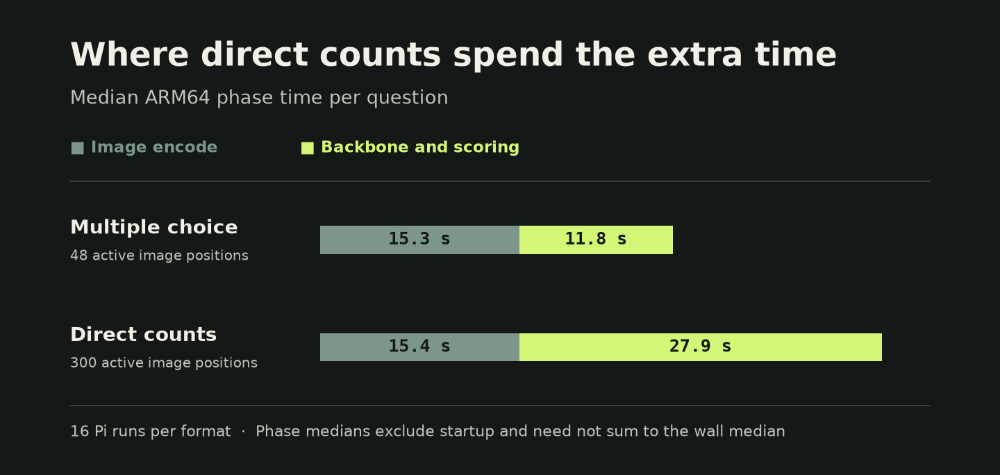

# Raspberry Pi benchmark

Hardware was a physical Raspberry Pi 4B with 4 GB RAM and four Cortex-A72 cores. Both engines used Liquid AI d1-2B Q4_K_M plus the Q8_0 projector and four CPU workers. The pinned llama.cpp revision was `8642541b255bfb5dc39cd351a178be09013a55d6` with OpenBLAS for eligible projector operations, Flash Attention, FP32 keys and values, and polling disabled. [llama.cpp revision](https://github.com/ggml-org/llama.cpp/commit/8642541b255bfb5dc39cd351a178be09013a55d6)

| Set | Cases | Assembly correct | llama.cpp correct | Full-set assembly median on Pi |
| --- | ---: | ---: | ---: | ---: |
| Original mixed | 48 | 42 | 40 | 27.39 s |
| Independent mixed | 16 | 14 | 14 | 27.56 s |
| Direct counts | 16 | 8 | 8 | 43.62 s |

The full-set reference used the same pinned llama.cpp build revision on x86 CPU. Accuracy uses ground-truth labels. Direct counts use the same ten-level ordinal score head on both engines. All sixteen returned digits match and both engines have a mean absolute count error of 0.75. Original mixed includes an accuracy subset of 36 binary questions, with 34 correct in each engine.

## Same-input timing on the Pi

Four cases per format ran on both engines with alternating execution order, warm filesystem caches, fresh processes, and one fresh image encode per question. Latency includes startup through the returned result. Peak RSS is the maximum process high-water mark across the four runs for each engine. Speedup is the median of the four per-case ratios. Background CPU load exceeded the campaign’s idle target. The Pi llama.cpp answers matched the x86 references on all eight probes.

| Format | Assembly median | llama.cpp median | Median paired speedup | Assembly peak RSS | llama.cpp peak RSS |
| --- | ---: | ---: | ---: | ---: | ---: |
| Multiple choice | 28.02 s | 70.19 s | 2.54× | 1,436 MiB | 1,609 MiB |
| Direct counts | 43.55 s | 70.65 s | 1.62× | 1,432 MiB | 1,613 MiB |

Per-question assembly timings start from decoded RGB. The llama.cpp endpoint accepts PNG and decodes it as part of the request. Reported wall times include engine startup and fresh inference. The profiles and raw metrics record the exact route used.

[All 80 answers and available paired timings](answers.csv) · [Original mixed report](reports/choices-original.json) · [Independent mixed report](reports/choices-independent.json) · [Direct-count report](reports/counts.json)



The [packed Q6 comparison](reports/packed-q6.json) tests the old and corrected activation capacity with the same score files. All 16 optimized count score buffers and all four [choice regression buffers](reports/choice-regression.json) matched their respective earlier builds. The [48-position count diagnostic](reports/sparse-counts.json) shows the failure that led to retaining the full backbone for counts.

## Rebuild the benchmark inputs

Download `test_2d.jsonl`, `test_2d.parquet`, `test_3d.jsonl`, and `test_3d.parquet` into `build/cv-source/` from CV-Bench revision `bc284db50d036958861cb60cdd7b77612052ce0d`. The three [frozen manifests](manifests/) contain the source IDs, labels, and input hashes. The original mixed manifest includes six pilots with `block: 0`. The 48 reported cases have `block > 0`. [CV-Bench source files](https://huggingface.co/datasets/nyu-visionx/CV-Bench/tree/main)

With the model and virtual environment set up, run these commands from the repository root.

```sh
python3 -m pip install pyarrow
prepare=research/d1-640x480/prepare_cvbench.py
python3 "$prepare" build/cv-source "$MODEL" build/cv-original --extended
python3 "$prepare" build/cv-source "$MODEL" build/cv-independent --extended \
  --seed 20261111-cv-acceptance --block 1 \
  --exclude-manifest benchmarks/manifests/choices-original.json
python3 "$prepare" build/cv-source "$MODEL" build/cv-counts --numeric \
  --seed 20261111-cv-numeric \
  --exclude-manifest benchmarks/manifests/choices-original.json \
  --exclude-manifest benchmarks/manifests/choices-independent.json
```

Compare generated `manifest.json` files with the frozen manifests before using the inputs. The original manifests were built with Pillow 12.3.0. To replay the eight-car case, extract its question specification and run the image through the release CLI.

```sh
jq '.cases[] | select(.id == "2d-0221") | .question_spec' \
  benchmarks/manifests/counts.json > build/eight-cars.json
python3 research/d1-640x480/decide.py "$MODEL" "$PROJECTOR" \
  build/cv-counts/images/2d-0221.png build/eight-cars.json
```

The chart generator reads the report JSON files. Run `python3 -m pip install matplotlib` and `python3 benchmarks/plot.py` to regenerate the figures.
